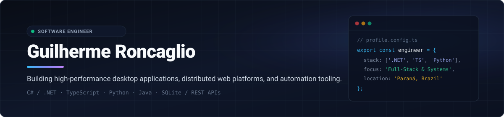
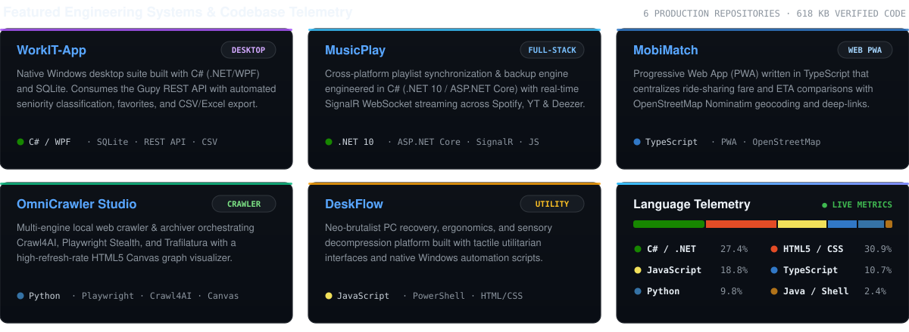

  

  
  
  
  

---

  

---

### Technology & Tooling Matrix

<table>
  <thead>
    <tr>
      <th width="26%" align="left">Architectural Layer</th>
      <th align="left">Technologies &amp; Runtimes</th>
    </tr>
  </thead>
  <tbody>
    <tr>
      <td><b>Backend &amp; Native Desktop</b></td>
      <td>
        
        
        
        
        
        
      </td>
    </tr>
    <tr>
      <td><b>Web &amp; Frontend Systems</b></td>
      <td>
        
        
        
        
        
      </td>
    </tr>
    <tr>
      <td><b>Automation, Crawling &amp; Data</b></td>
      <td>
        
        
        
        
        
        
      </td>
    </tr>
  </tbody>
</table>
